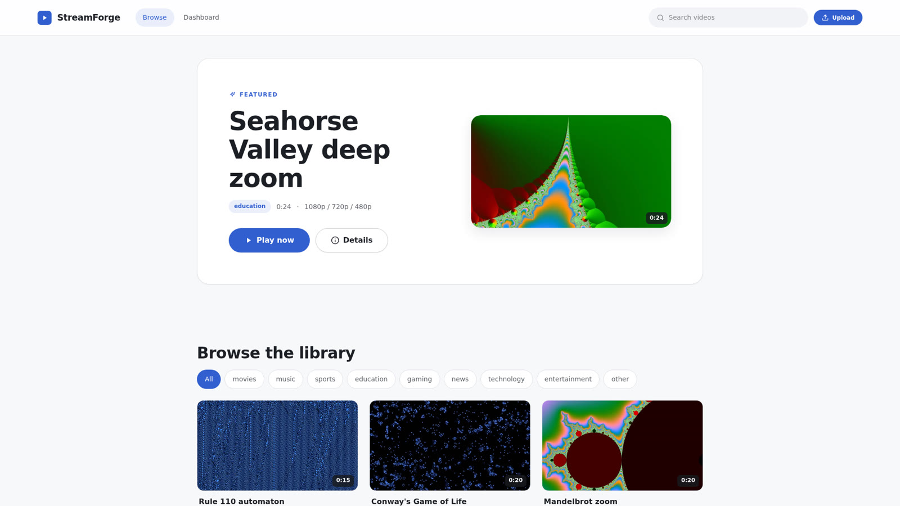
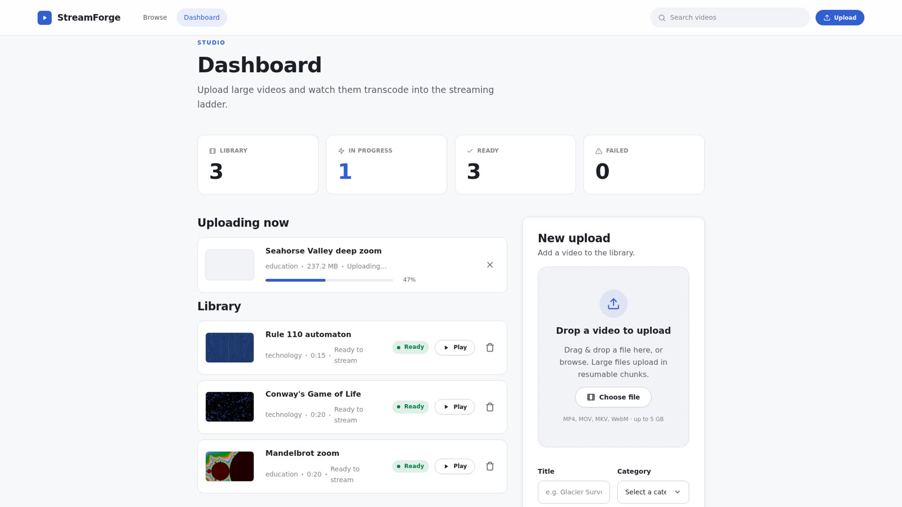
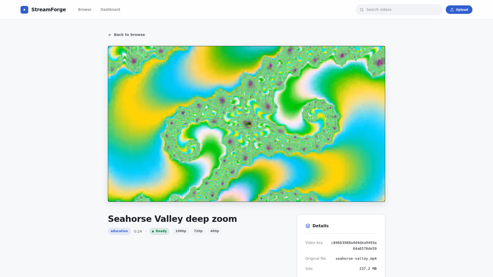

# StreamForge

A dockerized video streaming platform engineered for secure, scalable,
low-latency delivery. Upload large video files directly to object storage,
transcode them into a multi-resolution adaptive ladder, and stream them back as
MPEG-DASH in the browser — Netflix style.

<p>
  <a href="https://github.com/devpparikh/video-streaming-platform/actions/workflows/ci.yml"></a>
  
  
  
  
  
  
  
</p>



| Upload in progress | Adaptive playback |
| --- | --- |
|  |  |

## Highlights

- **Direct-to-S3 resumable uploads.** The browser uploads multi-gigabyte files
  straight to S3 via presigned multipart URLs — the API issues URLs and
  finalizes, but never proxies the bytes. Interrupted uploads resume from the
  last received part.
- **Asynchronous transcoding.** Celery workers claim jobs with a DynamoDB lease
  (one worker per video, stale leases reclaimed), run ffmpeg to produce a
  1080p / 720p / 480p DASH ladder (no upscaling beyond the source), and upload
  the manifest + segments back to S3.
- **Adaptive DASH streaming.** Segments are served with HTTP range support and
  correct MIME types; the frontend plays them with dash.js and adapts quality
  to bandwidth.
- **Catalog with soft delete.** Cursor-paginated listing by category or full
  feed (DynamoDB GSIs), plus hide / restore / hard-delete.
- **Local-first, cloud-ready.** Runs end-to-end on a local AWS emulator
  (S3 + DynamoDB) with one command and no accounts or tokens; switch to real
  AWS by changing environment variables only — no code changes.

## Architecture

```
   ┌──────────┐   S3 multipart   ┌─────────┐    enqueue    ┌────────┐
   │  React   │   (presigned)    │ FastAPI │ ───────────►  │ Celery │
   │ frontend │ ◄──────────────► │ backend │  ◄─ status ─  │ worker │
   └──────────┘  DASH/metadata   └────┬────┘               └───┬────┘
        ▲           (S3 / DB)         │                        │ ffmpeg
        └─────────────────────────────┘                  transcode → DASH
                                       │                        │
                          Redis (broker + result backend)  ─────┘
                                       │
                 S3 = object store  ·  DynamoDB = metadata
```

| Service      | Tech                       | Responsibility                                          |
| ------------ | -------------------------- | ------------------------------------------------------- |
| `backend`    | FastAPI (Python 3.12+)     | Presigned multipart uploads, catalog API, DASH streaming |
| `worker`     | Celery + ffmpeg            | Transcode raw video → multi-resolution DASH             |
| `redis`      | Redis 7                    | Celery broker + result backend                          |
| `aws`        | moto server                | Local S3 + DynamoDB emulator (in-memory)                |
| `aws-init`   | boto3 script (one-shot)    | Creates the bucket + table on startup, then exits       |
| `frontend`   | React 19 + Vite + dash.js  | Upload dashboard, catalog, player                       |

## Quick start

Runs the whole stack — frontend, API, worker, Redis, and a local AWS emulator —
with one command. No AWS account, emulator token, or Terraform needed.

**Prerequisites:** Docker + Docker Compose.

```bash
# 1. Create the environment files from the checked-in templates
cp .env.example .env                     # root: worker concurrency (optional)
cp backend/.env.example backend/.env     # backend + worker config
cp frontend/.env.example frontend/.env   # frontend API base URL

# 2. Start everything (the aws-init service creates the bucket and table)
docker compose up --build
```

Then open:

| URL                                   | What                       |
| ------------------------------------- | -------------------------- |
| http://localhost:5173                 | Frontend (upload + browse) |
| http://localhost:8000/api/health      | Backend health check       |
| http://localhost:8000/docs            | Interactive API docs        |

> The emulator ([moto server](https://docs.getmoto.org/en/latest/docs/server_mode.html),
> the same library the backend tests mock AWS with) keeps state in memory, so
> the library resets when the `aws` container restarts.

## Local development (without full compose)

Run the dependencies in containers and the app processes on the host for faster
reloads:

```bash
# Start Redis + the AWS emulator, and provision the bucket + table
docker compose up redis aws aws-init -d

# Backend API (in backend/)
uv sync
uvicorn app.main:app --reload --port 8000

# Celery worker (in backend/)
celery -A app.workers.celery_app:celery_app worker --loglevel=info

# Frontend (in frontend/)
pnpm install && pnpm dev
```

## How it works

**Upload (4-step handshake).** `POST /api/uploads` initiates and returns a
`video_key` + S3 `upload_id` + part plan → the client requests presigned `PUT`
URLs (`/parts:sign`), uploads parts directly to S3, and can list already-received
parts (`/parts`) to resume → `POST /api/uploads/{key}/complete` finalizes and
enqueues a transcode job. The backend validates content type and size and never
touches the file bytes.

**Transcode.** A worker claims the job with a lease (`locked_until`), renews it
while encoding, runs `ffprobe` + `ffmpeg -f dash` to build the resolution ladder,
uploads `manifest.mpd` and segments to `uploads/{key}/dash/`, then marks the
video `ready`. Failures roll the job back to the queue and retry (up to 3×).

**Stream.** `GET /api/videos/{key}/dash/{file}` serves the manifest and segments
from S3 with `Accept-Ranges` / `Content-Range` support and correct MIME types
(`application/dash+xml`, `video/mp4`). dash.js requests the ladder and adapts.

Status flows: `uploading → queued → processing → ready | failed`.

## Project structure

```
video-streaming-platform/
├── backend/            # FastAPI app, Celery workers, tests          → backend/README.md
│   └── app/{clients,common,core,modules,repositories,workers}
├── frontend/           # React + Vite + TypeScript client            → frontend/README.md
│   └── src/{api,app,components,hooks,lib,pages,styles}
├── infra/terraform/    # S3 bucket + DynamoDB table for real AWS      → infra/terraform/README.md
├── docker-compose.yml  # Full local stack
└── .env.example        # Root env template (compose substitution)
```

## Testing

```bash
# Backend (pytest + httpx, S3/DynamoDB mocked in-memory with moto)
cd backend && uv run pytest --cov=app
uv run ruff check . && uv run ruff format --check .

# Frontend (Vitest + React Testing Library)
cd frontend && pnpm test
pnpm lint && pnpm typecheck && pnpm build
```

[CI](.github/workflows/ci.yml) runs all of the above on every pull request.

## Deploying to real AWS

No code changes required — point the same environment variables at AWS:

```bash
AWS_ENDPOINT_URL=                 # empty → boto3 uses real AWS endpoints
AWS_PUBLIC_ENDPOINT_URL=          # empty → real endpoint for presigned URLs
AWS_DEFAULT_REGION=<your-region>
S3_BUCKET=<your-bucket>
S3_USE_PATH_STYLE=false           # real S3 prefers virtual-hosted style
AWS_ACCESS_KEY_ID=<real-key>
AWS_SECRET_ACCESS_KEY=<real-secret>
```

Provision the bucket and table with the Terraform under `infra/terraform/`
(`terraform init && terraform apply`, with AWS credentials configured). It
creates the same resources `backend/scripts/init_aws.py` creates locally.

## Documentation

- [Backend](backend/README.md) — API reference, data model, transcoding pipeline, config
- [Frontend](frontend/README.md) — stack, pages, upload flow, API type generation
- [Infrastructure](infra/terraform/README.md) — Terraform resources and DynamoDB key design

## Scope

This is an MVP focused on the upload → transcode → stream path. It intentionally
has no authentication or user accounts, DASH only (no HLS/DRM), and targets a
single region. All videos are public once `ready`.

## License

[MIT](LICENSE)
